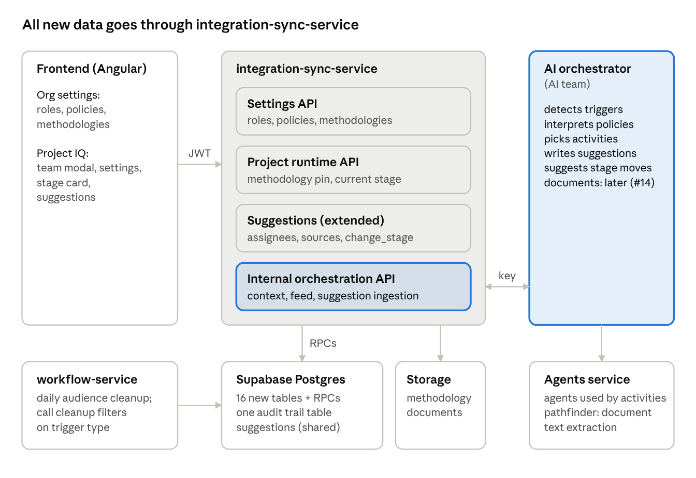

# COM · Architecture: decisions, scope, terminology, system overview

> Source: `docs/MOON-2389 Client Operating Model.docx.pdf` pp. 4–8 · Source ID `com`
> Architecture tab, dated **Oct 26, 2026**, author **Artem Derevyanko**.

**Summary line (p. 4):** Roles, policies and versioned methodologies live in `integration-sync-service`
(ISS) and reach the AI orchestrator through a scoped internal API; the AI team detects triggers and writes
role-targeted suggestions back into the existing suggestion store.

## The eleven decisions (pp. 4–5)
Each is a recommendation; the ones depending on product input also appear in Open questions.

| # | Decision | Why |
|---|---|---|
| 1 | Use **Stage** and **Activity** everywhere. Tables prefixed `client_methodology_*`, `client_policies*`, `client_activities`, `project_team_role*`. | Meeting on 20 Oct renamed Gate → Stage and Action → Activity; Figma follows it. Prefixes avoid clashes with existing `collection_methodology`, `llm_policies*`, `subscriber_role_hierarchy`, `project_stage`. |
| 2 | An Activity belongs to **exactly one container: a Policy or a Stage**. A Stage references 0..N Policies and also holds its own direct Activities. | Figma editor shows both in Stage 1 "Initiation": the "New Project Kickoff" policy block and a direct "Identify stakeholders" activity. Single ownership removes the copy/origin-tracking logic MOON-2394 describes. |
| 3 | Methodologies are edited as a **draft** and **published** into an **immutable version snapshot**. Projects **pin a version id**. Policies keep an **append-only revision history**. | A project must keep its version (MOON-2393). A policy edit must not rewrite history (MOON-2389). How projects pick up a new version is still OQ #9. |
| 4 | The editor saves the whole tree in one call: `PUT /client-methodologies/{id}/structure`. A plpgsql RPC applies it atomically with an optimistic revision check. | Canvas has undo/redo and one Save button. ISS has **no Python transactions** (supabase-py only), so atomic multi-row writes must be RPCs. |
| 5 | One always-on, append-only **`operating_model_audit_trail`** table is both the audit log **and** the outbox for the AI event feed. | Existing `tenant_audit_trail` skips service-role writes, is opt-in per tenant and is pruned after 30–180 days. |
| 6 | Project Team Roles are an **org library**. A member's roles hang off their `project_assignment` row. Users get a default role for prefill. Deleting a role cascades to its assignments and activity links; UI asks for confirmation first. | Matches MOON-2390. Real FK with ON DELETE CASCADE ⇒ removing a member removes their roles, no cleanup trigger. A project owner with no assignment row holds no roles until added to the team; no row is created implicitly. |
| 7 | Project runtime state lives in a new table: the **current stage**. Per-activity state comes later (Future phase). Possibly in scope: OQ #19, #20, #29. | Figma shows the stage bar; orchestrator needs to know which stage's activities apply. `project.project_stage` is a fixed Pre-Sale / Delivering / Inactive enum and can't hold this. Deviations, adherence, manual marking are future. |
| 8 | Orchestrator suggestions **reuse the existing suggestion store**. Add assignees, source attribution and one typed suggestion for stage moves, `project.methodology.change_stage`. | Suggestions are stored and applied in ISS today. Figma activity types already map onto existing executable suggestion types. |
| 9 | The AI team gets a **separate `/internal/orchestration/*` router behind a scoped service key**. | Today's single `X-API-KEY` reads every tenant with all feature flags on. |
| 10 | Methodology documents stored by ISS in **Supabase Storage**. File type checked **by content**, not name or client MIME. pathfinder `/textextract` used later for parsing. | ISS already has FileStorage and upload guards. pathfinder's storage keys aren't unique and it trusts client MIME. |
| 11 | New operating-model writes that span several rows/tables, need a transaction, or must produce an event for the AI team **go through ISS APIs**. A single field the browser already writes stays a direct Supabase write. | Validation, audit and events need one write path. Project team (people, access levels, roles) meets all three tests → moves to ISS: `PUT /projects/{id}/team`. `users.default_project_team_role_id` meets none (one column, RLS + composite FK) → frontend writes it to Supabase. Direct writes to `project` and agent assignments stay as they are. |

## Scope and terminology (p. 5)
- **Uinno/Veda team builds:** storage, APIs, UI, suggestion delivery, contracts.
- **AI team builds:** the orchestrator — detects triggers, interprets policies, writes suggestion content, parses documents.

### Glossary (p. 6)

| Term | Meaning | Stored in |
|---|---|---|
| Methodology | Org-owned operating model, e.g. "Enterprise Delivery Framework v2". Type One-time or Recurring. | `client_methodologies` |
| Methodology version | Immutable published snapshot. Projects pin one. | `client_methodology_versions` |
| Stage | Ordered step ("Stage 1 · Initiation"). Called **Gate** in older tickets. | `client_methodology_stages` |
| Policy | Reusable rule: name, description, optional trigger and reason, plus own activities. Standalone or attached to stages. | `client_policies` |
| Activity | Unit of expected work: type, description, project roles, agent, prompt, required flag. | `client_activities` |
| Project Team Role | Functional role on a project (PM, BA, Designer). **Not an access level.** | `project_team_roles` |
| Current stage | Where a project is within its pinned methodology version. | `project_methodology` |

### Names already taken (pp. 6–7)

| Word | Existing meaning | How we avoid confusion |
|---|---|---|
| Stage | `project.project_stage` = Pre-Sale / Delivering / Inactive enum, shown as "Status". The **Certinia stage** ("7/8 Negotiation/Review") is read from Salesforce. | Always say **"methodology stage"** in code and API. UI label is OQ #19. |
| Role | "Access Roles" = `subscriber_role_hierarchy` (`users.role`). "Profiles" = `subscriber_user_profiles`. Project access level = Viewer 100 / Contributor 200 / Editor 300 / Administrator 400. | Table, API and UI label are "Project Team Role"; API path `/project-team-roles`. |
| Policy | `llm_policies*` (LiteLLM guardrails) and `auth_ip_policy`. | Prefix `client_policies`. Path `/client-policies`, never `/llm/policies`. |
| Methodology | Enum `collection_methodology` (sprint_based / continuous) on ticketing boards. | Prefix `client_methodology`. |
| Agent | `query_form` rows are Veda agents (Emily, Cosmo). `relay_agents` are suggestion prompt profiles. | `client_activities.agent_id` references `query_form(form_id)`, as `project_assignment.assigned_agent` already does. |
| Action | Reserved by the wider orchestration project. | Not used. |

### In scope (p. 7)
- Org role library, project role assignments, user default role.
- Policy library with activities, revisions and usage. Archive depends on OQ #8.
- Methodology CRUD and canvas save. Publish/versions depend on OQ #9; document upload on #14.
- Project methodology selection. Current stage possibly in scope (OQ #19, #20).
- Suggestion store changes: assignees, source attribution, `project.methodology.change_stage`.

### Possibly in scope (p. 7)
- Internal orchestration API, event feed, scoped service auth.
- Audit for every change in scope.

### Out of scope — AI team or later (p. 7)
- Trigger detection, policy interpretation, suggestion content generation.
- Methodology extraction from documents and the "Engage with Agent" model.
- Autonomous execution without human approval.
- Deviations, stage-advance check, adherence, manual activity marking, orchestrator autonomy, AI proposals, Suggestion Sets (→ Future phase).

## System overview (pp. 7–8)
Four new areas in ISS own every write. **The AI orchestrator never touches the database**: it reads
context and the event feed, and writes suggestions and stage moves through the internal API.

*Diagram (p. 8) — "All new data goes through integration-sync-service":*
- **Frontend (Angular)** — Org settings (roles, policies, methodologies); Project IQ (team modal, settings, stage card, suggestions) → calls ISS with **JWT**.
- **integration-sync-service** contains: **Settings API** (roles, policies, methodologies) · **Project runtime API** (methodology pin, current stage) · **Suggestions (extended)** (assignees, sources, change_stage) · **Internal orchestration API** (context, feed, suggestion ingestion).
- **AI orchestrator (AI team)** ↔ Internal orchestration API via **key**. Responsibilities: detects triggers, interprets policies, picks activities, writes suggestions, suggests stage moves, documents later (#14). Uses **Agents service** (agents used by activities; pathfinder document text extraction).
- ISS → **Supabase Postgres** via RPCs (16 new tables + RPCs, one audit trail table, suggestions shared) and → **Storage** (methodology documents).
- **workflow-service** → Postgres (daily audience cleanup; call cleanup filters on trigger type).

Two existing paths stay: the frontend still writes `project`, agent assignments and the new
`users.default_project_team_role_id` straight to Supabase, and DB triggers turn owner changes into events.
People on the project team go through ISS (`PUT /projects/{id}/team`). `suggestion-service` keeps
generating call suggestions unchanged.
