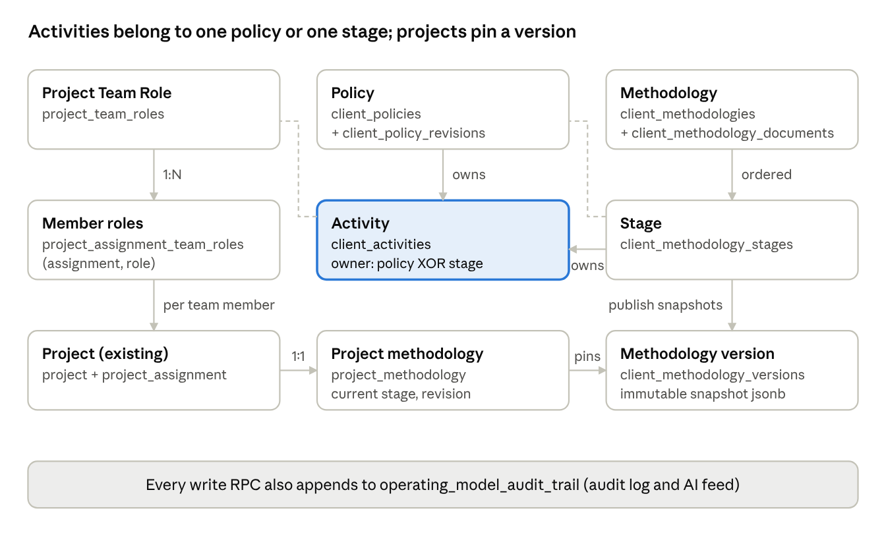

# COM · Domain model (tables)

> Source: `docs/MOON-2389 Client Operating Model.docx.pdf` pp. 8–14 · Source ID `com`

The model adds **16 tables** to the shared Supabase Postgres, plus one `suggestions` column, one `users`
column and a `UNIQUE (tenant, form_id)` constraint on `query_form`. Migrations live in
`integration-sync-service/migrations/sprint-NN/`.

*Entity diagram (p. 9) — "Activities belong to one policy or one stage; projects pin a version":*
Project Team Role (`project_team_roles`) —1:N→ Member roles (`project_assignment_team_roles` (assignment, role)) —per team member→ Project (existing: `project` + `project_assignment`) —1:1→ Project methodology (`project_methodology`: current stage, revision) —pins→ Methodology version (`client_methodology_versions`, immutable snapshot jsonb).
Policy (`client_policies` + `client_policy_revisions`) —owns→ **Activity** (`client_activities`, owner: policy XOR stage) ←owns— Stage (`client_methodology_stages`) ←ordered— Methodology (`client_methodologies` + `client_methodology_documents`). Stage —publish snapshots→ Methodology version.
Dashed (join tables): Role↔Activity via `client_activity_roles`; Stage↔Policy via `client_methodology_stage_policies`.
Not drawn: `audiences`, `audience_members`, `service_credentials`.
Footer: every write RPC also appends to `operating_model_audit_trail` (audit log and AI feed).

## Conventions for every table (pp. 9–10)
- `id uuid PK default gen_random_uuid()`.
- `tenant bigint NOT NULL REFERENCES subscriber(tenant)`.
- Audit columns `created_at, created_by, updated_at, updated_by`. Append-only tables only have the first two.
- **RLS** enabled on every table, with a RESTRICTIVE `tenant_isolation` policy and **no permissive policy**. Tables reachable only through ISS (service role), as `ticketing_ticket_events` already is.
- **RPCs:** `SECURITY INVOKER`, then `REVOKE ALL ON FUNCTION … FROM PUBLIC, anon, authenticated` and `GRANT EXECUTE … TO service_role`. A browser JWT therefore can't call `/rpc/publish_client_methodology` with a forged actor.
- **Triggers** fire on browser writes to `project` and `project_assignment`, so their functions run `SECURITY DEFINER`, owned by postgres, fixed `search_path` (otherwise inserts into RLS-protected tables would break today's owner/team saves).
- Unique names use `name_key text GENERATED ALWAYS AS (lower(btrim(name))) STORED`.
- Ordered children use `position int` running 1..N, checked by `require_contiguous_positions` (`src/shared/utils/positioning.py`). UNIQUE is `DEFERRABLE INITIALLY DEFERRED` so a reorder can run inside one RPC.
- Status values are Postgres enums created in a guarded `DO $$` block (migration safe to re-run).

## Roles (p. 10)

| Table | Columns | Constraints and indexes |
|---|---|---|
| `project_team_roles` | `name` text (1–100 chars), `name_key`, `position` int, `is_default` bool | UNIQUE (tenant, name_key). UNIQUE (tenant, position) deferrable. UNIQUE (tenant, id) — target of composite FK from users. Defaults seeded by trigger on subscriber insert + one-off backfill. **Seed list (MOON-2390), in order:** Project Manager, Product Owner, Business Analyst, Solution Architect, Engineer, QA Lead, Delivery Lead, Executive Sponsor. Seeding skips names the tenant already has (by name_key). |
| `project_assignment_team_roles` | `assignment_id` uuid → `project_assignment(id)` ON DELETE CASCADE, `role_id` uuid → `project_team_roles` CASCADE | PK (assignment_id, role_id). Index (tenant, role_id). Written only by `save_project_team`. BEFORE INSERT trigger rejects agent rows (`assigned_user` is null) and roles from another tenant. |
| `users.default_project_team_role_id` (new column) | uuid, nullable. Composite FK (subscriber, default_project_team_role_id) → `project_team_roles(tenant, id)` ON DELETE SET NULL (default_project_team_role_id) (PG15 syntax) | No trigger, no endpoint. Composite FK keeps role in user's tenant; deleting a role clears only this column. Frontend writes it via existing Supabase users update; users RLS limits to self or tenant admin. |

## Policies and activities (pp. 11–12)

| Table | Columns | Constraints and indexes |
|---|---|---|
| `client_policies` | `name`, `name_key`, `description` text, `trigger_type` text (catalog key, nullable), `trigger_reason` text (catalog key, nullable), `trigger_params` jsonb NOT NULL default `'{}'` (values for the reason's parameters, e.g. a threshold), `status` (active / archived), `revision` int, `archived_at`, `archived_by` | UNIQUE (tenant, name_key) WHERE status='active'. CHECK: description not blank OR trigger_type set (meeting 2: a trigger, a description, or both). CHECK: trigger_reason only when trigger_type set. CHECK: `jsonb_typeof(trigger_params)='object'`, and `'{}'` when trigger_type null; ISS validates contents. "Owner and audit metadata" covered by created_by/updated_by, revision history and audit trail. |
| `client_policy_revisions` | `policy_id`, `revision` int, `snapshot` jsonb (policy + resolved activities), `created_at`, `created_by` | PK (policy_id, revision). Append-only: trigger rejects UPDATE and DELETE. |
| `client_activities` | `policy_id` uuid nullable → client_policies CASCADE, `stage_id` uuid nullable → client_methodology_stages CASCADE, `name`, `type` text (catalog key), `description`, `agent_id` uuid → query_form(form_id), `prompt` text, `is_required` bool, `position` int | CHECK `num_nonnulls(policy_id, stage_id) = 1`. UNIQUE (policy_id, position) and UNIQUE (stage_id, position), both deferrable. Composite FK (tenant, agent_id) → query_form(tenant, form_id) ON DELETE SET NULL (agent_id). |
| `client_activity_roles` | `activity_id` → client_activities CASCADE, `role_id` → project_team_roles CASCADE | PK (activity_id, role_id). Index (role_id) for role-usage counts. |

**One shape for every policy (pp. 11–12).** A policy has a trigger, a description, or both (at least one,
per meeting 2). The trigger is optional routing metadata saying *when to look* at the policy; it is not a
second kind of policy. The description says what to do and how; the orchestrator reads it whenever
present. A policy without a trigger is evaluated by its text alone; one without a description is
interpreted from name, trigger, reason, params and activities. No catch-all trigger key required; Veda
does not turn descriptions into rules — interpreting text is the orchestrator's job.

**Trigger parameters (p. 12).** Type and reason stay real columns (orchestrator and policy list filter on
them; CHECKs depend on them). Anything a reason needs beyond its name (threshold, metric, time window)
goes in `trigger_params`. Each (type, reason) pair in the ISS catalog declares a **Pydantic model** for its
params; a pair without params accepts only `{}`. ISS validates on create/update, and
`GET /operating-model/catalog` returns each model as JSON Schema so the Create Policy form renders fields
without a frontend release. Each policy revision stores the params; a published version references the
revision it was built from, so params are pinned too.
Catalog changes are additive: a new reason or optional param needs nothing else. Renaming/removing a key or
making a param required needs a data migration **and the AI team's agreement**. Veda stores and serves
params; the orchestrator decides when the condition is met.
**Not now:** several triggers per policy, or AND/OR conditions (Figma shows a single trigger). If that changes,
the three columns move 1:1 into a `client_policy_triggers` child table.

## Methodologies (pp. 12–13)

| Table | Columns | Constraints and indexes |
|---|---|---|
| `client_methodologies` | `name`, `name_key`, `type` (one_time / recurring), `status` (draft / active / archived), `revision` int, `current_version_id` uuid nullable, `archived_at`, `archived_by` | UNIQUE (tenant, name_key) WHERE status <> 'archived'. current_version_id is a deferrable FK to versions. |
| `client_methodology_stages` | `methodology_id` → client_methodologies CASCADE, `name`, `description`, `position` | UNIQUE (methodology_id, position) deferrable. |
| `client_methodology_stage_policies` | `id` uuid (client-generated, the policy item's id), `stage_id` → stages CASCADE, `policy_id` → client_policies ON DELETE RESTRICT, `position` (shared sequence with the stage's direct activities) | PK (id). UNIQUE (stage_id, policy_id). Index (policy_id) for policy usage. |
| `client_methodology_versions` | `methodology_id` → client_methodologies RESTRICT, `version_number` int, `snapshot` jsonb, `snapshot_hash` text, `change_note` text, `published_at`, `published_by` | UNIQUE (methodology_id, version_number). Append-only. |
| `client_methodology_documents` | `methodology_id` → CASCADE, `name` text (original filename), `mime` text (from content check, never client header), `size` bigint, `storage_bucket` text, `storage_path` text, `sha256` text, `created_at`, `created_by` | UNIQUE (storage_bucket, storage_path). Column names follow `ticketing_attachments`. Newest row = current document. |

## Project runtime (p. 13)

| Table | Columns | Constraints and indexes |
|---|---|---|
| `project_methodology` | `project` uuid PK → project CASCADE, `methodology_id` RESTRICT, `version_id` RESTRICT, `assigned_at`, `assigned_by`, `current_stage_id` uuid nullable, `current_stage_set_at`, `current_stage_set_by`, `revision` int | One row per project; no row = no methodology. An RPC checks current_stage_id exists in the pinned snapshot. |

## Cross-cutting (pp. 13–14)

| Table | Columns | Constraints and indexes |
|---|---|---|
| `operating_model_audit_trail` | `seq` bigint identity, `txid` xid8 DEFAULT `pg_current_xact_id()`, `occurred_at`, `actor_type` (user / ai / system / service), `actor_id`, `entity_type`, `entity_id`, `action`, `project` nullable, `before` jsonb, `after` jsonb, `context` jsonb | Indexes (tenant, entity_type, entity_id, seq desc), (tenant, project, seq desc), (txid, seq) for the feed cursor. Append-only. |
| `audiences` | `id`, `tenant`, `project` → project CASCADE, `created_at` | RLS tenant isolation. Deleted by daily cleanup once no row targets it. |
| `audience_members` | `audience` → audiences CASCADE, `user_id` → users CASCADE, `via_role_id` → project_team_roles SET NULL | PK (audience, user_id). Index (user_id, audience) for the RLS lookup. |
| `suggestions` (new column) | `deduplication_key` text (named as on `feed_items` and `subscriber_events`) | UNIQUE (tenant, deduplication_key) WHERE deduplication_key IS NOT NULL, **whatever the status** — a replayed event never recreates an applied/dismissed suggestion. |
| `service_credentials` | `name`, `key_hash` (SHA-256), `scopes` text[], `allowed_tenants` bigint[] (null = all), `last_used_at`, `revoked_at`. **No tenant column** (platform credentials). | UNIQUE (key_hash). RLS on, no policy. Detail in AI team topics tab. ⚠ AI Labs later asked for KMS-issued short-lived tokens instead — see `topics/ai-integration-contract.md`. |

### The 16 new tables (count check)
`project_team_roles`, `project_assignment_team_roles`, `client_policies`, `client_policy_revisions`,
`client_activities`, `client_activity_roles`, `client_methodologies`, `client_methodology_stages`,
`client_methodology_stage_policies`, `client_methodology_versions`, `client_methodology_documents`,
`project_methodology`, `operating_model_audit_trail`, `audiences`, `audience_members`, `service_credentials`.
