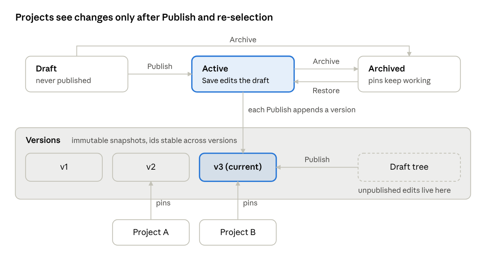

# COM · Methodology lifecycle, versioning, snapshot, policy revisions

> Source: `docs/MOON-2389 Client Operating Model.docx.pdf` pp. 14–17 · Source ID `com`

> **Depends on open question #9.** This section describes **option C**: each project stays on its version
> until a project admin upgrades it. With option B, Publish moves every project to the new version (no upgrade
> step). With option A there's no draft, Publish or version. Archive depends on OQ #8.

Edits change only the draft. Projects see a change only after Publish creates a new immutable version
**and** a project admin selects it.



*Diagram (p. 14) — "Projects see changes only after Publish and re-selection":* Draft (never published)
—Publish→ Active (Save edits the draft) ⇄ Archived (pins keep working) via Archive / Restore; Draft can
also be Archived directly. Each Publish appends a version: v1, v2, **v3 (current)**; the Draft tree holds
unpublished edits and Publish turns it into the next version. Project A pins v2; Project B pins v3.
Versions are immutable snapshots; **ids are stable across versions**. Project A stays on v2 after v3 is
published, moving only when a project admin re-selects the methodology.

## States (p. 15)

| Status | Meaning | Can be selected for a project |
|---|---|---|
| `draft` | Created, never published. | No |
| `active` | Has ≥1 published version. Edits after that are an unpublished draft. | Yes; current version is the default. |
| `archived` | Hidden from lists and selection. Already-pinned projects keep working. | No |

## Rules (p. 15)
- **Save** (`PUT …/structure`) works in any status except archived. Bumps `revision` (only a concurrency counter; snapshots are versions); never touches versions.
  - **Ids come from the client.** In the structure RPC, an id already in this draft is updated; an unknown id is inserted with that value. An id belonging to another methodology/tenant fails `422 operating_model.methodology.invalid_id` (reveals nothing about the owner). No temporary keys, no id mapping.
- **Publish** creates version N+1, sets `current_version_id`, moves draft → active.
  - **Idempotent:** if the new snapshot hash equals the current version's hash, returns the existing version.
- **Archive** allowed while projects are pinned. **Restore** returns to previous status.
- **Delete** only while never published (RESTRICT FK from versions enforces it). Otherwise `409 operating_model.methodology.in_use`; UI offers Archive.
- `has_unpublished_changes` = true when revision moved since last publish, **or** any attached policy's live revision is newer than the snapshot's.

## Publish RPC (pp. 15–16)
`publish_client_methodology(p_tenant, p_methodology_id, p_expected_revision, p_actor, p_note)`
1. Lock the methodology row (`FOR UPDATE`), compare revision with `p_expected_revision`. Mismatch → `operating_model.methodology.revision_conflict` (409).
2. Validate the tree: ≥1 stage; every activity has a name and known type; roles and agents belong to the tenant; attached policies are active.
3. Build the snapshot and its `snapshot_hash`.
4. Insert into `client_methodology_versions`, then update `current_version_id`, status and published revision.
5. Write `operating_model.methodology_version.published` to `operating_model_audit_trail`.

## Snapshot shape (p. 16)
The stored snapshot holds methodology, stages, direct activities, and **policy references `{id, revision}`**.
Policy content stays in immutable `client_policy_revisions` (never copied into methodology records, per
MOON-2391 / MOON-2394). Reads (`GET …/versions/{id}` and internal API) return the **resolved view** below by
joining those revisions; the result never changes. Ids stable across versions ⇒ stage pointer survives an upgrade.

```json
{
  "methodology": {"id": "…", "name": "Enterprise Delivery Framework", "type": "one_time"},
  "version": {"id": "…", "version_number": 3, "published_at": "2026-11-12T10:00:00Z"},
  "stages": [
    {
      "id": "…", "name": "Initiation", "description": "…",
      "items": [
        {
          "kind": "policy", "id": "…", "policy_id": "…", "revision": 4,
          "name": "New Project Kickoff", "description": "…", "status": "active",
          "trigger": {"type": "project.methodology.stage_changed", "reason": null, "params": {}},
          "items": [
            {"kind": "activity", "id": "…", "name": "Kick-off meeting",
             "type": "scheduling.calendar.create_event", "description": "…",
             "roles": [{"id": "…", "name": "PM"}], "agent": {"id": "…", "name": "Emily"},
             "prompt": "…", "is_required": true}
          ]
        },
        {"kind": "activity", "id": "…", "name": "Identify stakeholders", "type": "insight_content",
         "roles": [{"id": "…", "name": "BA"}], "agent": null, "prompt": null, "is_required": false}
      ]
    }
  ]
}
```
> Note: in this example the activity `type` is shown as a suggestion-type key (`scheduling.calendar.create_event`)
> in one place and an activity-type key (`insight_content`) in another; elsewhere the doc says activity `type`
> is an **activity type catalog key** (e.g. `calendar`). Treat the example as illustrative.

## Policy revisions (p. 16)
- Every policy save (fields or activities) bumps `client_policies.revision` and appends a row to `client_policy_revisions` inside the same RPC.
- A policy edit never changes a published methodology version. Methodologies using it show **"policy updated since last publish"** until republished.
- Publishing is blocked while a stage references an archived policy (`operating_model.methodology.policy_archived`).

## Upgrading a project to a newer version (pp. 16–17)
- A project stays on its pinned version until a project admin re-selects the methodology (OQ #18). Project Settings shows **"v4 available"**.
- On upgrade, the RPC keeps `current_stage_id` if that stage still exists in the new snapshot; otherwise resets to the first stage.
- All recorded as one `project.methodology.version_upgraded` event.
- Type **Recurring** is stored and returned. Decided in #10: a One-Time methodology stops after its last stage; a Recurring one starts again at stage 1, like sprints.
