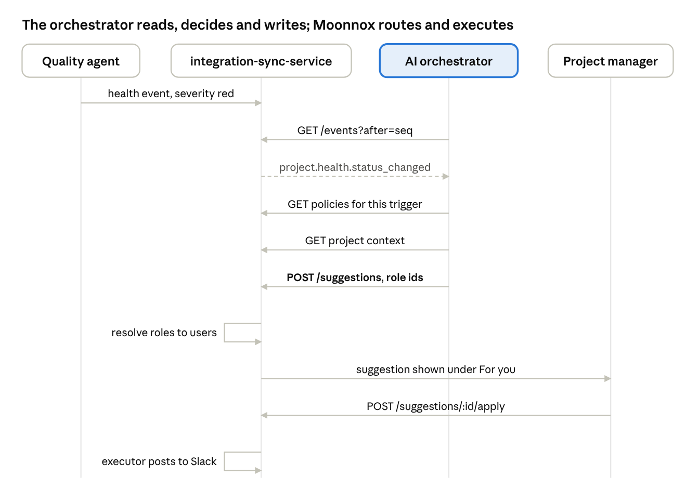

# COM · AI team: topics to discuss (Veda's proposal to the AI team)

> Source: `docs/MOON-2389 Client Operating Model.docx.pdf` pp. 39–47 · Source ID `com`
> 🚧 Original banner: "A proposal to discuss, not an agreement. We don't know your architecture yet… Where your design differs, we change ours."
> **AI Labs answered this tab on Oct 30, 2026** → `kb/sources/ai-labs-answers.md`; side-by-side in `kb/topics/ai-integration-contract.md`.

## In short (p. 39)
- Veda stores the client's way of working: team roles, policies, methodologies (stages + activities). Admins manage them in the UI.
- The AI team decides what should happen and when, using that data plus signals they already have (calls, project health, chat).
- AI team sends suggestions. Whether addressed to roles or specific people is open (topic 4). Veda shows them to the right people and runs them when applied.
- People stay in control: in v1 the orchestrator never changes a project directly.

## Topics at a glance (pp. 39–40)

| # | Topic | What Veda proposes | What Veda needs from AI team |
|---|---|---|---|
| 1 | How the orchestrator learns something happened | AI reads an event feed (`GET /events?after={cursor}`); a webhook or own channel also work | Which option fits |
| 2 | What it reads from Veda | Read endpoints for project context, methodology versions, a client's policies and the catalog | Anything missing |
| 3 | How suggestions come back | `POST /projects/{project_id}/suggestions` with type, payload, targets, dedup key and source; activity type picks the suggestion type | Whether the shape works |
| 4 | Who receives a suggestion | Not decided: AI sends roles and Veda finds people, or AI sends people | Which option; whether a specific person is ever needed |
| 5 | Shared lists and exact keys | One catalog in Veda, read with `GET /internal/orchestration/catalog` | Confirm lists and names |
| 6 | Stage changes | Project admin moves the stage; AI can suggest with `project.methodology.change_stage` | Whether this works; whether AI detects stage changes itself |

Topics 1–5 block Veda's build; topic 6 can follow.

## The whole loop in one example (p. 40)


*Sequence diagram — "The orchestrator reads, decides and writes; Moonnox routes and executes"* (participants:
Quality agent, integration-sync-service, AI orchestrator, Project manager):
1. Quality agent → ISS: health event, severity red.
2. Orchestrator → ISS: `GET /events?after=seq` → receives `project.health.status_changed`.
3. Orchestrator → ISS: GET policies for this trigger; GET project context.
4. Orchestrator → ISS: **`POST /suggestions`, role ids**.
5. ISS resolves roles to users; suggestion shown under **"For you"** to the PM.
6. PM → ISS: `POST /suggestions/:id/apply`; ISS executor posts to Slack.

Flow A in words: health turns red → feed event → orchestrator looks up policies for that trigger ("Low Project
Health") and loads context (team + roles, methodology, current stage) → one suggestion per activity in the
policy (e.g. "Post a Slack update" for the PM) → Veda shows it to the PM → PM applies → Veda posts to Slack.
Methodologies work the same way: entering a stage emits `project.methodology.stage_changed` and the
orchestrator suggests that stage's activities.

## 1. How does the orchestrator learn that something happened? (p. 41)
Example: on the **Coca Cola** project, the scope sign-off call just ended, and an hour later health dropped green → red.
Three options:
- **Feed (Veda's proposal):** every few seconds `GET /events?after={cursor}`, save where you stopped. AI hosts nothing; either side can be down and resume.
- **Webhook:** Veda calls an AI URL. Faster, but Veda needs retries and AI needs a public endpoint.
- **Something else** the AI team has in mind.

Each event says what happened and to which records (by id), not the full data:

| Event | When |
|---|---|
| `project.methodology.stage_changed` | A project moved to another stage |
| `project.methodology.assigned` / `replaced` / `removed` | A project got, changed or lost its methodology |
| `project.health.status_changed` | Health changed (existing signal) |
| `project.team.changed` | People or roles on a project changed |
| `operating_model.policy.created` / `updated` / `archived` / `deleted` | Policy lifecycle |
| `operating_model.methodology_version.published` | A new methodology version exists |

## 2. What does the orchestrator need to read? (pp. 41–42)
Read endpoints under `/internal/orchestration`:

| Endpoint | Gives |
|---|---|
| `GET /projects/{project_id}/context` | One project: team with roles, methodology version and current stage, applicable policies |
| `GET /methodology-versions/{version_id}` | Whole version: stages, activities, policies |
| `GET /tenants/{tenant}/policies?trigger_type=` | A client's active policies with activities |
| `GET /catalog` | Shared lists and exact keys, same for every client. Client's own team roles come from project context. |

Example context (Coca Cola, shortened):
```json
{
  "project": {"id": "…", "name": "Coca Cola", "status": "Pre-Sale"},
  "team": [
    {"user_id": "…", "name": "Anna Smith", "access_level": 400, "is_owner": true,
     "roles": [{"id": "…", "name": "PM"}]}
  ],
  "methodology": {
    "id": "…", "name": "Enterprise Delivery Framework",
    "version": {"id": "…", "version_number": 3},
    "current_stage": {"id": "…", "name": "Discovery and Scope", "position": 2, "total": 5}
  },
  "policies": {"attached_to_current_stage": ["…"], "standalone": ["…"]}
}
```

## 3. How does the orchestrator send suggestions back? (pp. 42–43)
The orchestrator never changes a project itself. `POST /projects/{project_id}/suggestions` under
`/internal/orchestration`. Project in the path ⇒ one request = one project; Veda checks the key may see that
project before reading the body.
```json
{
  "suggestions": [{
    "type": "messaging.slack.post_update",
    "title": "Post Slack update",
    "description": "Project health turned red; share a status update with the team.",
    "payload": {"message": "…", "type": "internal"},
    "targets": [{"kind": "project_role", "id": "<PM role id>"}],
    "deduplication_key": "policy:…:project:…:event:981:activity:…",
    "source": {"kind": "operating_model.policy", "policy_id": "…", "activity_id": "…", "event_seq": 981}
  }]
}
```
- `targets` = list of `{kind, id}`; `project_role` or `user`; new kinds (e.g. team) can be added later.
- Same `deduplication_key` twice → second ignored (retries safe). `source` records which policy/event led to it.
- Each suggestion accepted or rejected on its own; one bad item doesn't fail the rest.
- `type` must be an action Veda already runs; the activity type picks it:

| Activity type | Suggestion type |
|---|---|
| `email` | `messaging.email.send_email` |
| `calendar` | `scheduling.calendar.create_event` |
| `slack_teams` | `messaging.slack.post_update` or `messaging.teams.post_update` (depending on what the client connected) |
| `pm_tool` | `project.ticketing.create_ticket` or `project.ticketing.update_ticket` |
| `certinia_stage` | `project.certinia.update_stage` |
| `certinia_raid_create` | `project.certinia.create_raid_record` |
| `certinia_raid_update` | `project.certinia.update_raid_record` |
| `insight_content`, `generate_document` | None yet: Veda has no matching action |

Payloads follow the schema Veda already uses per type; exact schemas shared once the list is agreed.

## 4. Who receives a suggestion? (p. 43)
Example: "Post Slack update" is for the PM role. On Coca Cola, Anna is PM. If Anna leaves and Mark takes over,
who sees a still-waiting suggestion?
- **Send the role**; Veda finds who holds it now and after team changes (moves from Anna to Mark by itself).
- **Send the people**, chosen from the context; AI decides exactly, but must follow team changes itself.

*(AI Labs answered: the orchestrator picks the users — see ai-labs-answers.md Topic 4.)*

## 5. Shared lists and exact words (pp. 44–45)
Example of the risk: admin picks "Health scan", Veda stores `project.health.status_changed`; if the AI calls it
`health.changed`, the policy never fires and nobody sees an error.
Proposal: one catalog in Veda = single source of truth (same one the UI uses). Keys lowercase, never change once
used; labels display-only. Adding is safe; renaming/removing needs both teams. Unknown key → item rejected with clear error.

| List | Examples | Used for |
|---|---|---|
| Trigger types | `callpilot.call.ended`, `project.methodology.stage_changed`, `project.health.status_changed`, `agent.chat.message_sent` | When a policy applies |
| Trigger reasons | Depend on trigger, e.g. `low_health_score`, `health_declining` | The policy's "reason" |
| Activity types | `email`, `calendar`, `slack_teams`, `pm_tool`, `certinia_stage`, `certinia_raid_create`, `certinia_raid_update`, `insight_content`, `generate_document` | Each activity |
| Suggestion types | `messaging.email.send_email`, `scheduling.calendar.create_event`, `messaging.slack.post_update`, `messaging.teams.post_update`, `project.ticketing.create_ticket`, `project.ticketing.update_ticket`, `project.certinia.update_stage`, `project.certinia.create_raid_record`, `project.certinia.update_raid_record`, `project.methodology.change_stage` | Every suggestion sent |
| Event types | Topic 1 events, e.g. `project.methodology.assigned`, `project.methodology.stage_changed` | What happened |
| Target kinds | `project_role`, `user` | Who a suggestion is for |
| Source kinds | `operating_model.policy`, `operating_model.stage` | Why it was made |
| Methodology types | `one_time`, `recurring` | How a methodology runs |

`GET /internal/orchestration/catalog` — same for every client, changes only on deploy (cacheable). Example:
```json
{
  "trigger_types": [{
    "key": "project.health.status_changed", "label": "Health scan",
    "reasons": [
      {"key": "low_health_score", "label": "Health score is low"},
      {"key": "health_declining", "label": "Health is declining"}
    ]
  }],
  "activity_types": [
    {"key": "slack_teams", "label": "Slack/Teams",
     "suggestion_types": ["messaging.slack.post_update", "messaging.teams.post_update"]}
  ],
  "suggestion_types": [
    {"key": "messaging.slack.post_update", "label": "Post Slack update", "payload_schema": {"…": "…"}}
  ],
  "event_types": [{"key": "project.methodology.stage_changed", "label": "Stage changed"}],
  "target_kinds": ["project_role", "user"],
  "source_kinds": ["operating_model.policy", "operating_model.stage"],
  "methodology_types": ["one_time", "recurring"]
}
```
Trigger types/reasons should list only what the AI can really detect (else admins create policies that never fire).
A policy can have no trigger and only a description, e.g. "Before any client demo, check the latest RAID log"; then
the AI works out when it applies.

## 6. How do stage changes work? (pp. 45–46)
Example: Coca Cola is in "Discovery and Scope"; today's call signed off scope ⇒ should move to "Delivery".
Proposal: a project admin moves the stage in Veda; the orchestrator can suggest it with
`project.methodology.change_stage`, citing evidence ("Scope signed off on the call of Nov 18"). Only project admins
can apply ⇒ target members with access_level ≥ 400, or the project owner.
Need: does it work; will AI notice stage changes itself (e.g. from calls) or only react when a person moves it?

## Background — who does what (p. 46)

| | Veda (Uinno team) | AI team |
|---|---|---|
| Roles, policies, methodologies | Store them; admin UI | Read them |
| Noticing that something happened | Publishes the events it owns | Detects and interprets |
| Deciding what to suggest, and writing it | Checks the suggestion is valid | Owns |
| Who receives a suggestion | Shows it to the right people; turns roles into people if targeting roles | Picks the roles or people (topic 4) |
| Showing and running suggestions (email, Slack, Teams, calendar, Jira, Certinia) | Owns, with existing executors | — |
| Moving a project to the next stage | Stores it; project admin applies | Suggests it |

## Words we use (pp. 46–47)
Project Team Role · Policy (description + optional trigger + activities) · Trigger (event kind + optional reason) ·
Methodology (ordered stages; publishing freezes a version; each project uses one) · Stage · Activity (type, description,
roles, optional agent and prompt) · Suggestion (proposed action a person applies or dismisses).

## Technical details to settle (p. 47)
- **Access:** own revocable key per environment, sent as **`X-Service-Key`**, limited to reading data and writing suggestions, and to permitted clients.
- **Tracing:** send `X-Request-Id`; Veda logs it.
